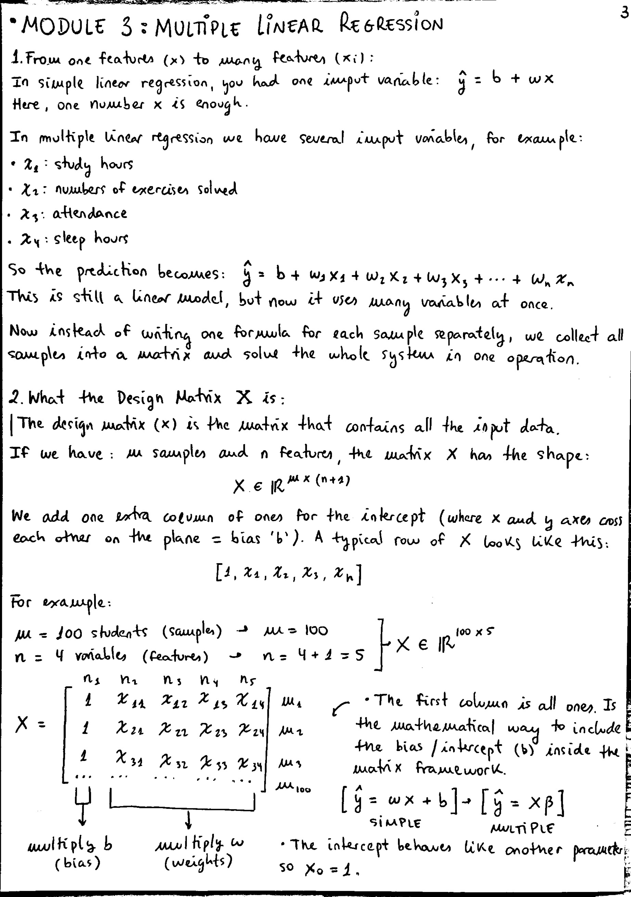
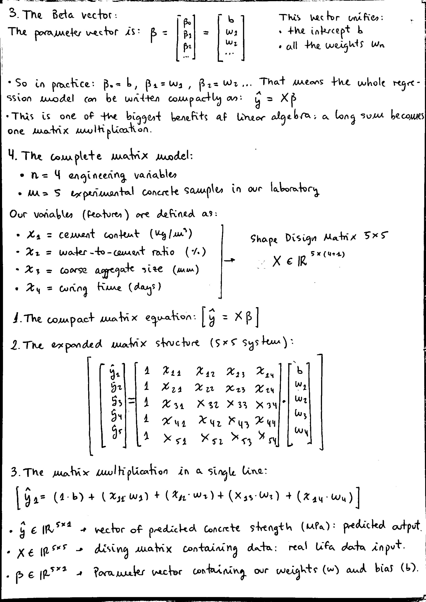
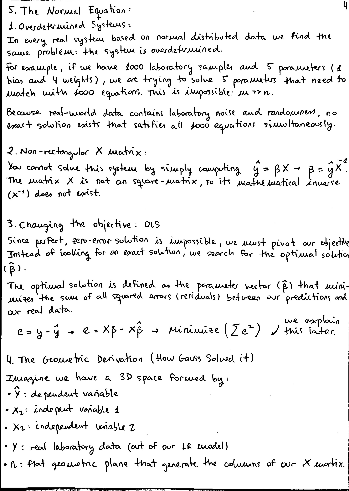
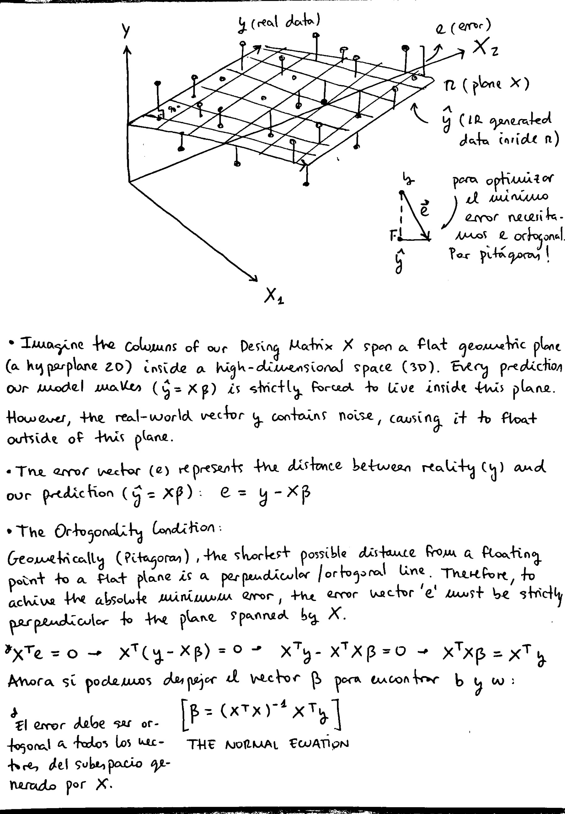
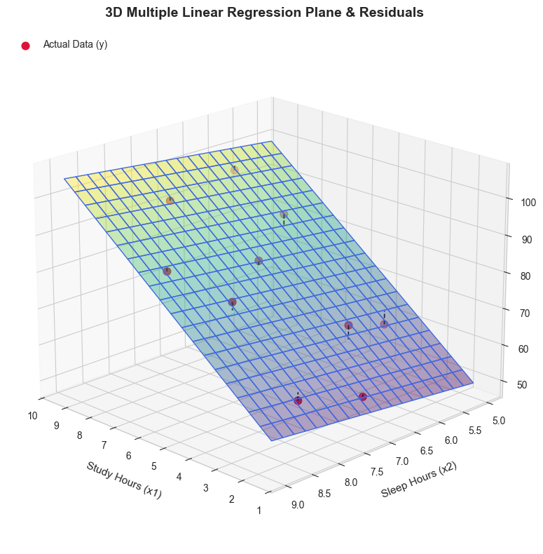
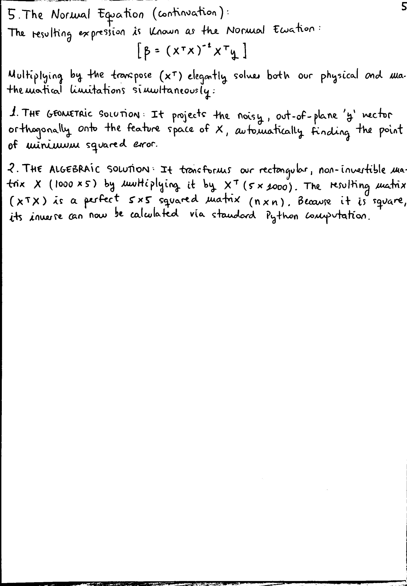

# Module 3 — Multiple Linear Regression

## Handwritten Notes

These are my handwritten notes for **Multiple Linear Regression**.

I worked through the mathematical foundations on paper before implementing the model in Python.

The notes follow my learning process, from representing a regression problem with multiple features to the matrix formulation and the **Normal Equation**.

---

## 1. Multiple Linear Regression

The first pages introduce the idea of using multiple features to predict a target variable.



---

## 2. Design Matrix and Model Representation

Here I work with the **Design Matrix**, the model parameters, and the matrix representation of the predictions.



---

## 3. Least Squares and the Overdetermined System

This section focuses on the Least Squares problem and why a system with more observations than parameters cannot generally be solved exactly.



---

## 4. Geometric Interpretation

Here I explore the geometric interpretation of the Least Squares solution, including the relationship between the residuals and the space represented by the model.



---

## Python graphical implementation of my hand-drawn pen sketch of before:



---

## 5. Normal Equation

The final page brings the previous ideas together and arrives at the **Normal Equation**.



---

## Final Idea

The main mathematical result of these notes is:

```text
β = (XᵀX)⁻¹Xᵀy
```

This gives the parameter vector that minimizes the squared residuals under the assumptions used in the Least Squares formulation.

These handwritten pages are my original study notes and represent the way I worked through the topic before implementing it in Python.
