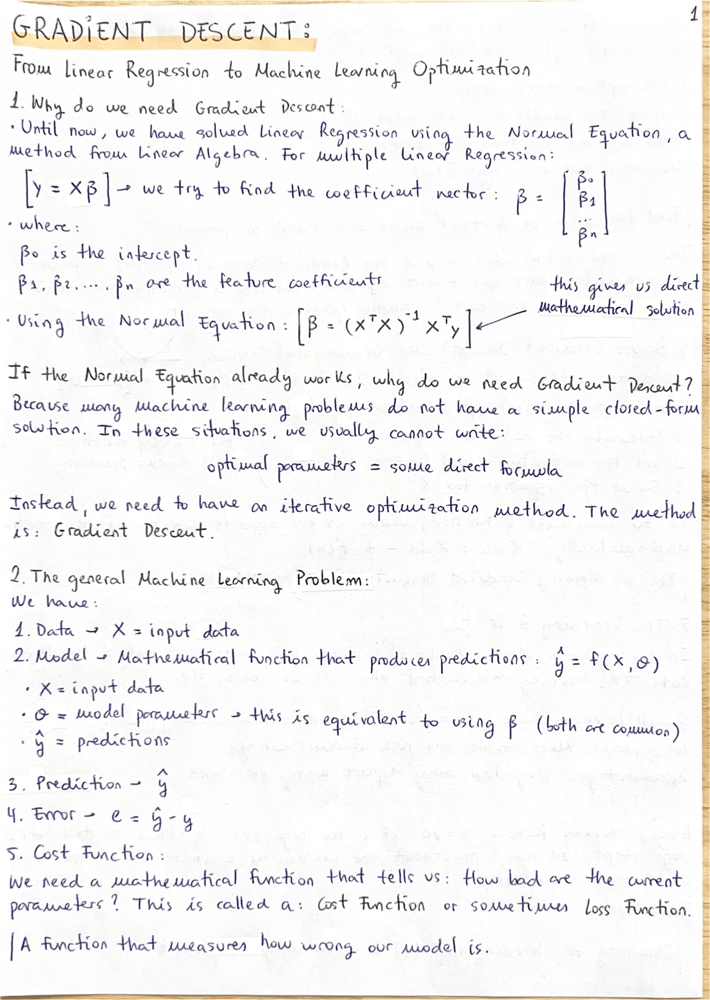
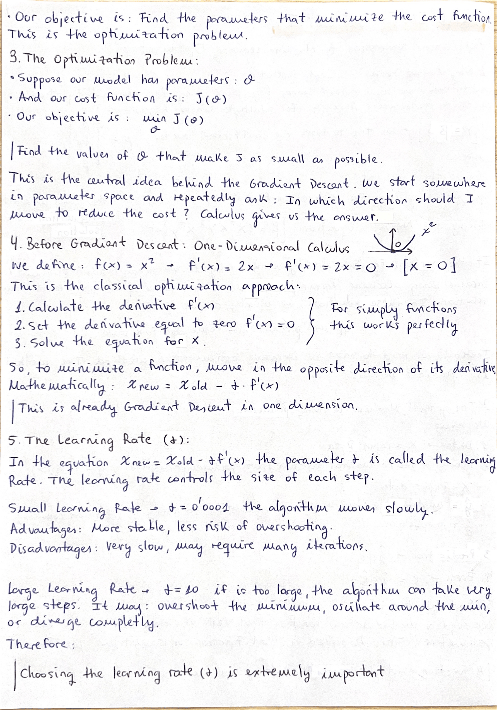
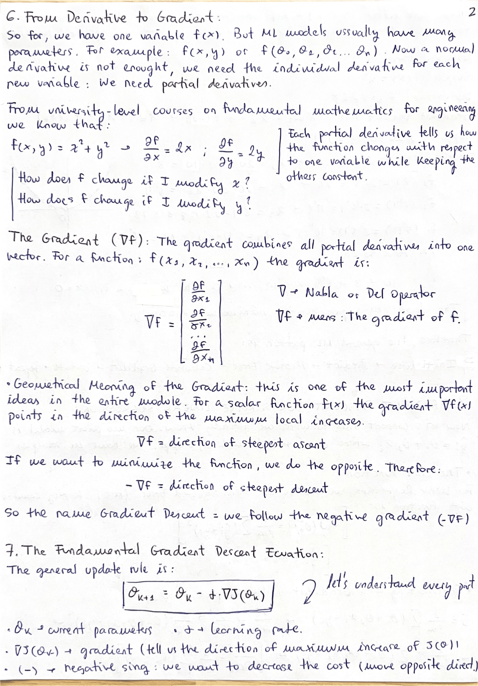
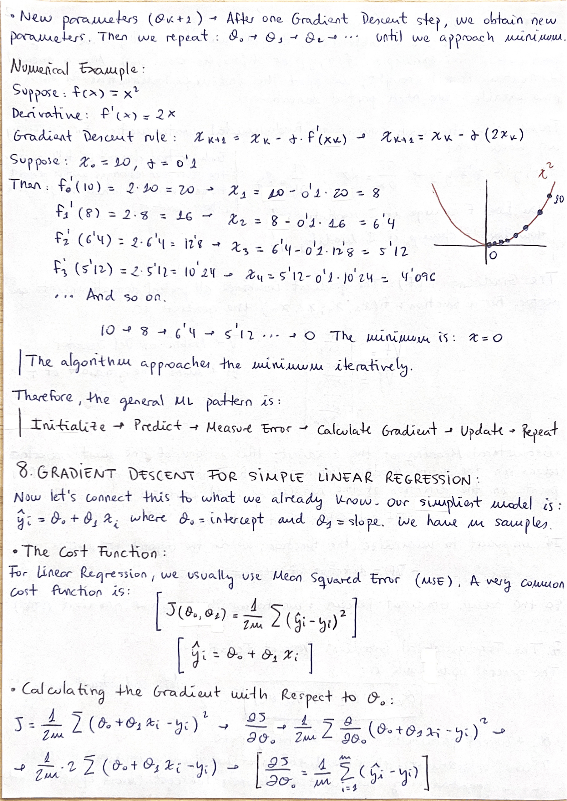
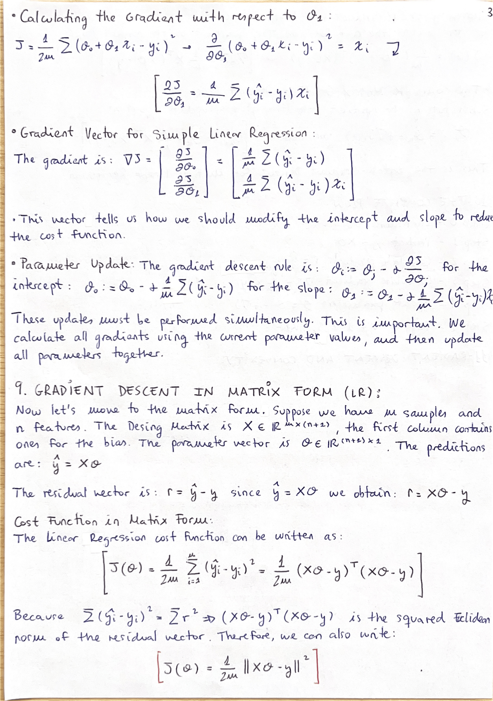
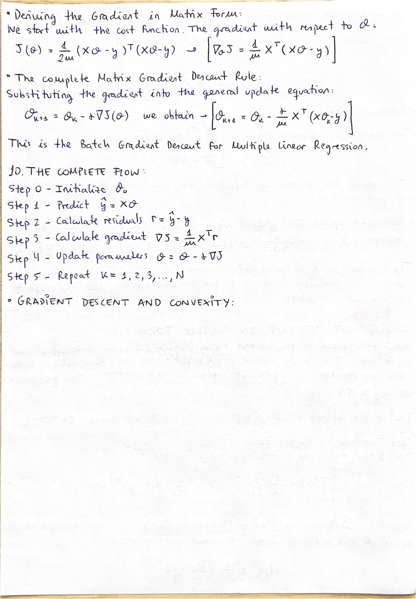

# Module 4 — Gradient Descent

## Handwritten Notes

These are my handwritten notes for **Gradient Descent**.

I worked through the main ideas, equations, and derivations on paper before implementing them in Python.

---

## 1. Gradient Descent

Introduction to the core motivation behind Gradient Descent: why we move beyond closed-form matrix solutions (like the Normal Equation $\beta = (X^T X)^{-1} X^T y$) toward iterative optimization. I break down the fundamental components of any machine learning problem—data matrix $X$, prediction function $\hat{y} = f(X, \theta)$, error vector, and cost function $J(\theta)$. I also introduce 1D calculus intuition ($f(x) = x^2$) and explore how the learning rate ($\alpha$) controls step size and stability.



---

## 2. Derivatives and the Gradient

Notes extending single-variable derivatives to multivariable calculus. I cover partial derivatives ($\frac{\partial f}{\partial x}$, $\frac{\partial f}{\partial y}$), constructing the gradient vector ($\nabla f$) using the Nabla operator. Crucially, I examine the geometric meaning of the gradient: $\nabla f$ points in the direction of steepest ascent, so taking the negative gradient ($-\nabla f$) directs us down the path of steepest descent. This yields the fundamental update equation: $\theta_{k+1} = \theta_k - \alpha \nabla J(\theta_k)$.



---

## 3. Cost Function

Here I work through a step-by-step numerical calculation on $f(x) = x^2$ with $\alpha = 0.1$, showing how iterative updates systematically move parameters toward zero. I formalize the iterative ML workflow (*Initialize $\rightarrow$ Predict $\rightarrow$ Error $
ightarrow$ Gradient $
ightarrow$ Update $
ightarrow$ Repeat*) and define the Mean Squared Error (MSE) cost function $J(\theta_0, \theta_1)$ for Simple Linear Regression, deriving its partial derivative with respect to the intercept $\theta_0$.



---

## 4. Gradient of Linear Regression

Derivation of the partial derivative with respect to the slope $\theta_1$, forming the full two-dimensional gradient vector $\nabla J(\theta)$. I highlight the necessity of simultaneous parameter updates. Next, I transition to high-dimensional matrix notation: defining the Design Matrix $X \in \mathbb{R}^{m \times (n+1)}$, parameter vector $\theta$, residual vector $r = X\theta - y$, and expressing the MSE cost function compactly in matrix form as $J(\theta) = \frac{1}{2m} \|X\theta - y\|^2$.



---

## 5. Gradient Descent Update

Mathematical derivation of the gradient in matrix notation ($\nabla_\theta J = \frac{1}{m} X^T (X\theta - y)$), leading directly to the Batch Gradient Descent matrix update rule: $\theta_{k+1} = \theta_k - \frac{\alpha}{m} X^T (X\theta - y)$. I map out the complete 6-step algorithmic execution flow from initialization to convergence and discuss the convex geometry of Linear Regression cost surfaces.



---

## 6. From Mathematics to Python

Connecting the handwritten mathematical derivations directly to vectorized Python code using NumPy. The matrix formulation maps seamlessly into fast tensor operations without loops: `y_pred = X @ theta`, `residuals = y_pred - y`, `gradient = (1/m) * (X.T @ residuals)`, and `theta -= alpha * gradient`. I also outline practical considerations like monitoring loss history across iterations and choosing optimal learning rates.



---

## Final Idea

These pages summarize the mathematical path I followed before implementing Gradient Descent:

```text
Function
   ↓
Derivative
   ↓
Gradient
   ↓
Cost Function
   ↓
Parameter Update
   ↓
Convergence
```

These handwritten pages are my original study notes and represent my reasoning process while learning the topic.